= Taiga User Guide

[[introduction-to-taiga]]
== Introduction to Taiga

_Taiga_ is an open-source project management tool with an intuitive interface and comprehensive support for Agile methodologies, including Scrum and Kanban.

Taiga helps project managers organize, track, and prioritize work using Agile methodologies, including Scrum and Kanban frameworks. As a powerful alternative to Jira or Trello, Taiga helps teams define deliverables, align priorities, and maintain transparency across ongoing activities and resource allocation.

Using Taiga, you can easily manage daily standups with your team. Create user stories that capture all required tasks, and include attachments, story points, internal requirements, client requests, and dependencies. Generate individual or bulk tasks and drag them into clear status swim lanes on the Sprint Taskboard. Story points, due dates, and blocked tasks are prominently displayed, making it simple to track high-priority items and assist team members facing blockers.

As Taiga offers robust customization options, you can easily configure and customize epics, user stories, tasks, issue workflows, custom fields, role permissions, integrations, and plugins. Create a project wiki for documentation and other content. To encourage team collaboration and engagement, highlight team member skills and contributions on the unique team board, such as highlighting a _Bug Hunter_ for issue reporting. In addition, use Taiga's powerful search capabilities to find any type of data across your project.

***

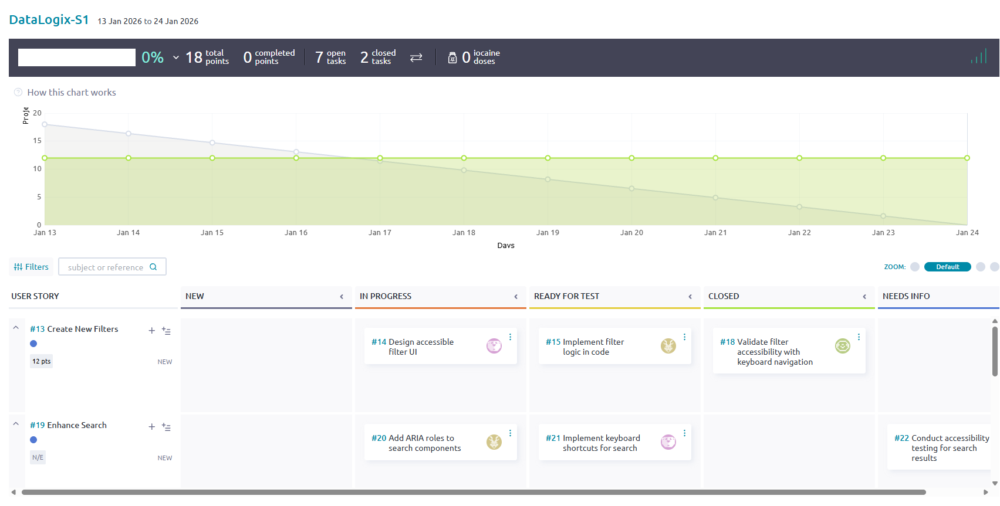

***

[[scrum-project-workflow]]
== Scrum project workflow

In Scrum, work typically moves through two main phases:

- _Backlog Management_: Prepare and prioritize work by creating and refining epics, user stories, and tasks.
- _Sprint Execution_: Create and plan sprints, assign stories and tasks to members, and track story and task progress through to completion.

***

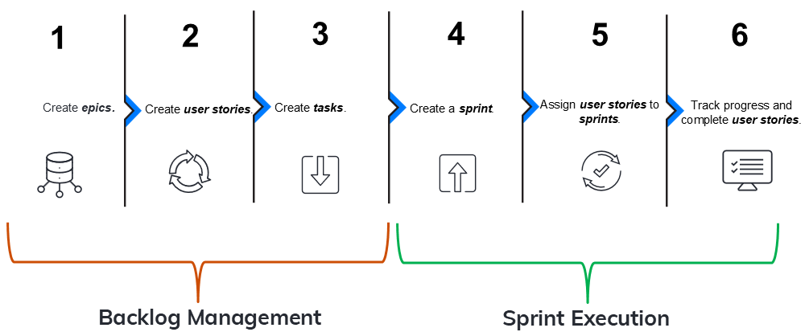

***

The following table summarizes each step in the workflow.

[options="header", cols="2,3,2,5,5"]
|===
| Seq.# | Step | Phase | Description | Example

| 1
| **xref:create-an-epic[Create epics]**
| Backlog Management
| Create _epics_, which group related user stories. Together, the user stories in an epic encapsulate work towards a specific product development.
| An epic called _User Management Accessibility Redesign_ includes user stories that define development related to accessibility features in the User Management application.

| 2
| **xref:create-a-user-story[Create user stories]**
| Backlog Management
| Within an epic and from the backlog, create _user stories_ that define specific development needed to accomplish the goal of the epic.
| In the epic called _User Management Accessibility Redesign_, there's a user story called _Change UI Labels_, which defines changing the UI text headings to comply with WCAG requirements.

| 3
| **xref:create-a-task[Create tasks]**
| Backlog Management
| Within each user story, create _tasks_, which break up the story work into smaller, manageable chunks that different members of the team can work on.
| For the user story, _Change UI Labels_, there are 3 tasks: _Propose New UI Labels_, _Update Text Labels in DB_, and _Test New UI Labels_. Each task is assigned to a different member of the team.

| 4
| **xref:create-a-sprint[Create a sprint]**
| Sprint Execution
| Create a _sprint_, a timeboxed period for completing user stories. Typically, multiple sprints are created well in advance of their start dates.
| A sprint called _DLogix-S1_ is a two-week sprint, starting on 1/12 and ending on 1/19.

| 5
| **xref:assign-stories-to-a-sprint[Assign user stories to sprints]**
| Sprint Execution
| From the backlog, according to deployment priorities, related work, and development dependencies, determine which user stories should be assigned to upcoming sprints, and assign them accordingly.
| For the sprint, _DLogix-S1_, assign the following user stories: _Change UI Labels_, _Create New Filters_, and _Enhance Search_.

| 6
| **xref:track-progress-and-complete-user-stories[Track progress and complete user stories]**
| Sprint Execution
| During a sprint, track the status of user stories on a sprint taskboard. During the daily standups, discuss any blockers, issues, and dependencies, and try to resolve them so that members can complete the work defined in the relevant stories. At the end of a sprint, all stories should have a completed status.
| One week into the _DLogix-S1_ sprint, the stories _Change UI Labels_ and _Create New Filters_ are _In Progress_, and _Enhance Search_ has a dependency on another team that is currently being resolved.
|===

[[scrum-backlog-management]]
== Scrum backlog management

During backlog management, you prepare and prioritize work by creating the key entities you will use to manage work on a daily basis: _epics_, _user stories_, and _tasks_. Managing these entities and following the Scrum workflow helps you organize and prioritize work, with the goal of delivering value within the defined timebox.

*Topics*:

* xref:create-an-epic[Create an epic]
* xref:create-a-user-story[Create a user story]
* xref:create-a-task[Create a task]

[[create-an-epic]]
=== Create an epic

Create an _epic_, which groups related user stories. Together, the user stories in an epic encapsulate work towards a specific product development.

For example, an epic called _User Management Accessibility Redesign_ includes user stories that define development related to accessibility features in the User Management application.

*Before you begin*

See xref:scrum-project-workflow[Scrum project workflow].

*Procedure*

1. From the https://tree.taiga.io/[Taiga] home page, under **My projects**, select the project you want.
2. On the project page, from the left sidebar, select **Epics**.
3. Select **+ Add Epic**.
4. On the following screen, enter your epic details.

***

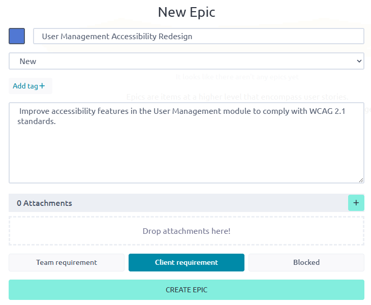

***

[options="header", cols="2,6"]
|===
| Field | Description

| Color ID
| Select a color that identifies the epic. + 
Alternatively, enter the hexadecimal color code.

| Epic Name
| Enter a unique name for your epic. + 
For example: _User Management Accessibility Redesign_

| Epic Description
| Enter a description for your epic, which should describe the type of product development for the epic. + 
For example: _Improve accessibility features in the User Management module to comply with WCAG 2.1 standards._

| Attachments
| If desired, upload or drop any relevant attachments, such as feature specs, customer requirements, etc.

| Team requirement / Client requirement / Blocked
a| Select one of the following:
* **Team requirement**: Work defined by user stories in the epic is work the development team feels is necessary but it is not a direct client request.
* **Client requirement**: Work defined by user stories in the epic is the result of a direct client request.
* **Blocked**: Work defined by the user stories in this epic currently _cannot_ be done, due to an external dependency or issue preventing its progress.
|===

5. Select **Create Epic**. +
The system creates the new epic and displays it in a new row on the **Epics** screen.

***

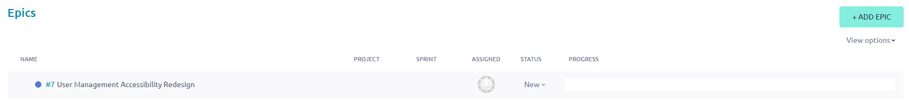

***

[options="header", cols="2,6"]
|===
| Field | Description

| Name
| Name of the epic.

| Project
| Project associated with the epic. + 
A blank value indicates that the project is the one in which the epic was created (the current project). If the epic was assigned to a project other than the one in which it was created, the name of the project is displayed in this field.

| Sprint
| Sprint to which the epic is assigned. + 
*Note:* This field is often blank because epics span multiple sprints. They are _not_ single-sprint items. Instead, epics are linked to their specific user stories or tasks, which get assigned to sprints.

| Assigned
| Member of the project to which the epic is assigned. + 
By default, this field is blank. Typically, this is assigned to the specific team member who is responsible for the high-level goal or initiative of the epic.

| Status
| Status of the epic. + 
By default, a new epic is set to **New**. Can be set to **New**, **Ready**, **In Progress**, **Ready for Test**, and **Done**.

| Progress
| Calculated rollup that reflects the completion status of all associated user stories (or Kanban cards) linked to the epic. + 
This is _not_ a manually editable field.
|===

*What to do next?* +
xref:create-a-user-story[Create a user story].

[[create-a-user-story]]
=== Create a user story

Create a _user story_ that defines specific development needed to accomplish the goal of the epic.

For example, in the epic called _User Management Accessibility Redesign_, create a user story called _Change UI Labels_, which defines changing the UI text headings to comply with WCAG requirements.

[NOTE]
====
There are two ways to create user stories— from the **Epics** dashboard or from the backlog. To emphasize the value of the project workflow, this procedure describes how to create user stories from the **Epics** dashboard.

To create a user story from the backlog, select **Scrum** > **Backlog**, select **+ User Story**, and associate the user story with the relevant epic.
====

*Before you begin*

xref:create-an-epic[Create an epic].

*Procedure*

1. Select the epic for which you want to create a user story.
2. Under **Related user stories**, select the **+** icon.

***

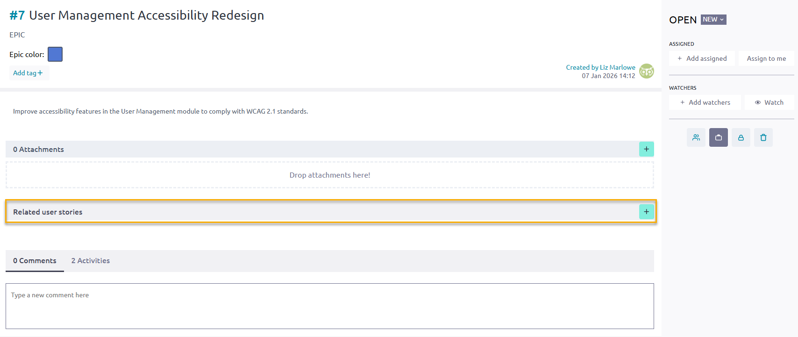

***

3. On the **Create a relationship with** screen, complete the fields.

***

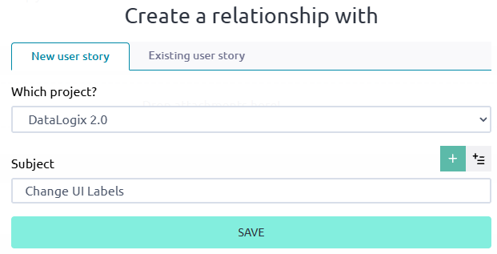

***

[options="header", cols="3,5"]
|===
| Field | Description

| New user story / existing user story
a| Do one of the following:
* To create a new story for the epic, select **New user story**.
* To select an existing story for the epic, select **Existing user story**.

| Which project?
| Select the project with which you want to associate the user story.

| Subject
| Enter the name of the story.
|===

4. Select **Save**. +
The system saves the story under **Related user stories** for the epic.

***

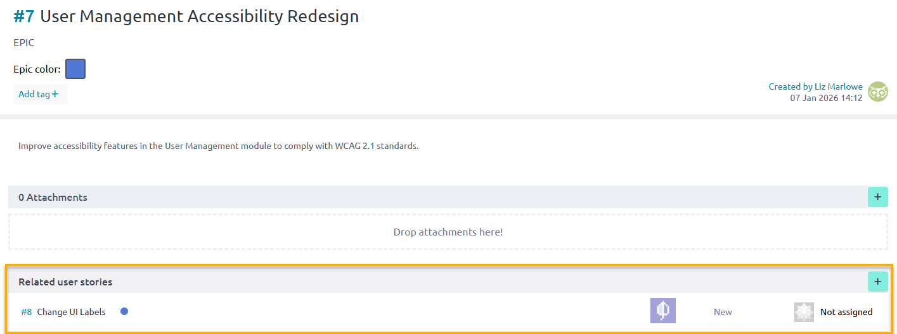

***

5. Now that you created the story, select it again and complete the additional fields.

***

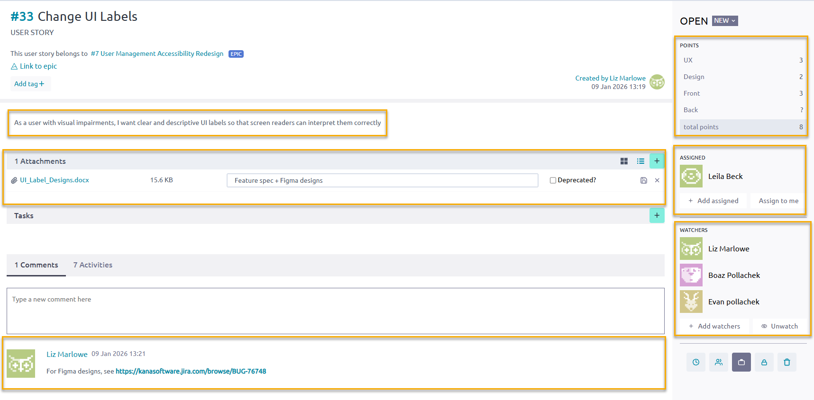

***

[options="header", cols="2,6"]
|===
| Field | Description

| Description
| Enter a description for the story, and select **Save**. + 
To write the description, use the Connextra template: "As a {user role}, I want to {achieve a goal/action} so that {I get a value or benefit}." + 
For example: _As a user with visual impairments, I want clear and descriptive UI labels so that screen readers can interpret them correctly._

| Attachments
| Upload any relevant files. + 
For example, this can include product specs, feature descriptions, etc.

| Comments
| Enter any relevant comments about the story. + 
For example, this can include URLs, information about dependencies, potential issues, etc.

| Points
| Enter the relevant story points for the relevant development areas. + 
For example, for a UI update, enter points for **UX**, **Design**, and **Front**.

| Assigned
| Select **+ Add assigned** and select a member from the list. To assign the story to yourself, select **Assign to me**.

| Watchers
| Select **+ Add watchers** and select the members you want to _watch_ the story. These members will receive email notifications when there are story updates and when the story's status changes.
|===

6. To create more stories for the epic, repeat these steps for the additional stories.

*What to do next?* +
xref:create-a-task[Create a task].

[[create-a-task]]
=== Create a task

Within each user story, create a _task_, which breaks up story work into smaller, manageable chunks that different members of the team can work on.

For example, for the user story _Change UI Labels_, there are 3 tasks: _Propose New UI Labels_, _Update Text Labels in DB_, and _Test New UI Labels_. Each task is assigned to a different member of the team.

*Before you begin*

xref:create-a-user-story[Create a user story].

*Procedure*

1. On the **User Story** screen, for **Tasks**, select the **+** icon.

***

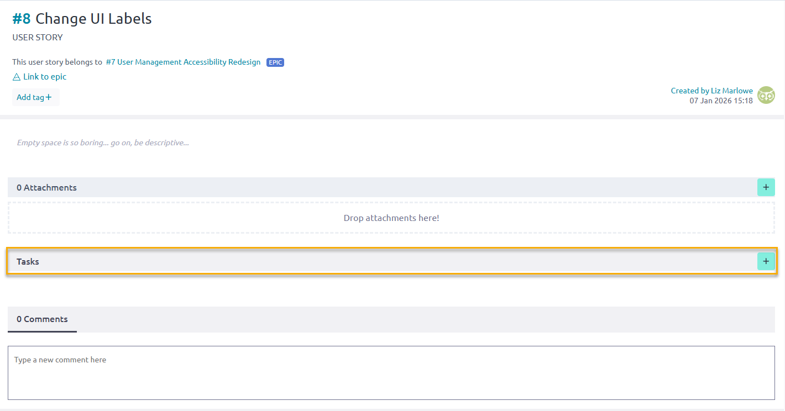

***

2. Under **Tasks**, in the new row, do the following:

   a. Enter a name for the task. For example: _Propose new UI labels that meet WCAG guidelines_. +
   b. From the drop-down menu next to the name, select the status of the task. By default, the status is **New**. (You can also update the status during the sprint on the sprint task board.) +
   c. From the third drop-down menu, select the task assignee, and select **Add**.

***

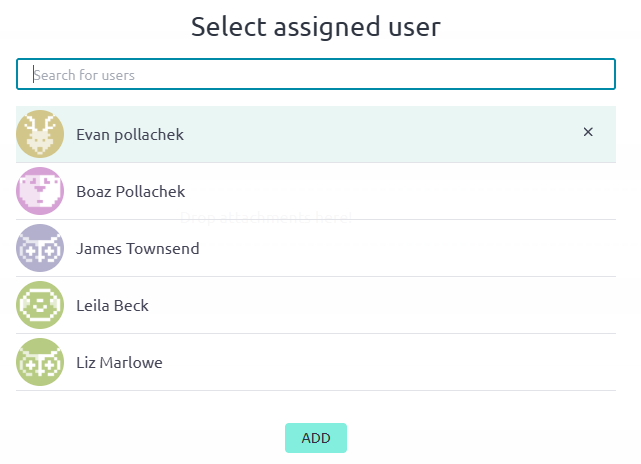

***

3. Hover over the row and select **Save**.

***

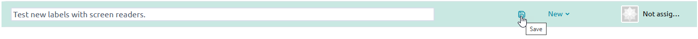

***

The system saves the new task.

***

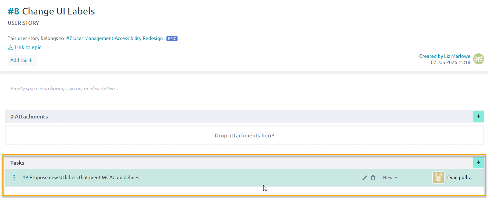

***

4. To create more tasks for the story, repeat these steps for the additional tasks.

***

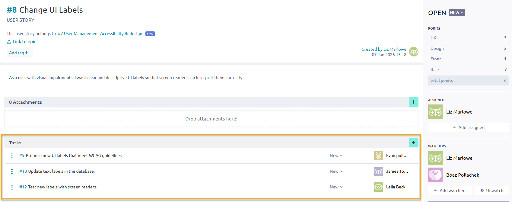

***

*What to do next?* +
xref:scrum-sprint-execution[Scrum sprint execution].

[[scrum-sprint-execution]]
== Scrum sprint execution

During sprint execution, you deliver the work that was prepared during backlog management. This phase includes planning sprints, assigning prioritized user stories to the sprint backlog, and coordinating daily progress.

Teams work collaboratively to complete stories within the sprint’s timebox, resolve blockers, and track progress using task boards or burndown charts. At the end of the sprint, completed work is reviewed and demonstrated, and the team reflects on improvements during the retrospective.

*Topics*:

* xref:create-a-sprint[Create a sprint]
* xref:assign-stories-to-a-sprint[Assign user stories to a sprint]
* xref:track-progress-and-complete-user-stories[Track progress and complete user stories]

[[create-a-sprint]]
=== Create a sprint

Create a _sprint_, a timeboxed period for completing user stories. Typically, multiple sprints are created well in advance of their start dates.

*Before you begin*

Complete all steps in xref:scrum-backlog-management[Scrum backlog management].

*Procedure*

1. On the project page, from the left sidebar, select **Scrum** and **Backlog**. +
   The backlog displays all existing user stories.

***

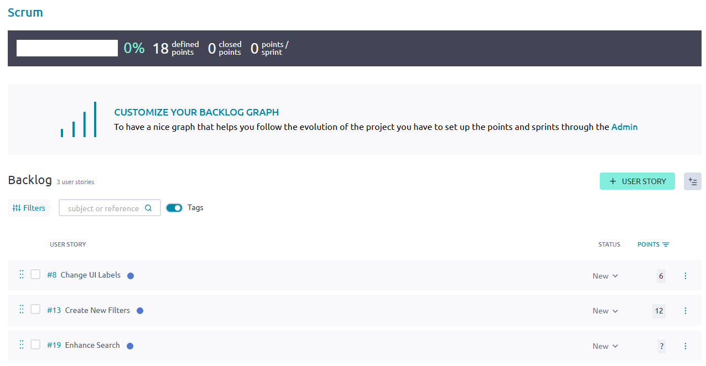

***

2. From **Sprints**, select **Add +**.
3. On the **New sprint** screen, enter the name of the sprint and the start and end dates, and select **Save**.

***

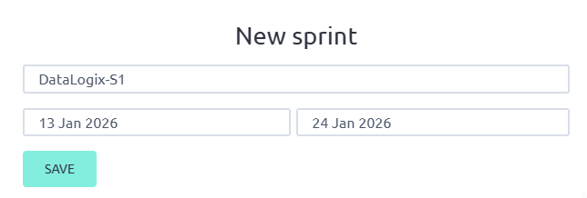

***

4. Select **Save**. +
   Under **Sprints**, the new sprint is now displayed.

***

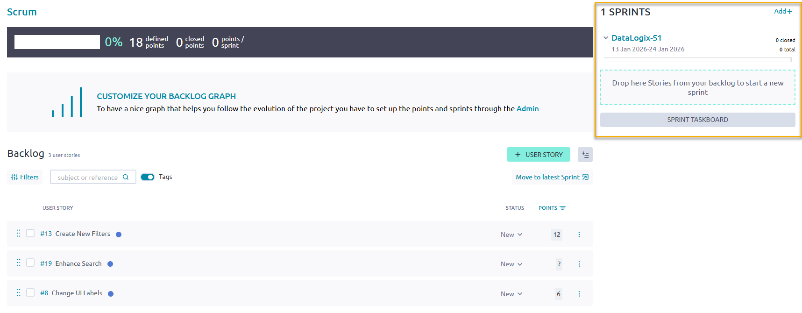

***

*What to do next?* +
xref:assign-stories-to-a-sprint[Assign user stories to a sprint].

[[assign-stories-to-a-sprint]]
=== Assign user stories to a sprint

From the backlog, according to deployment priorities, related work, and development dependencies, determine which user stories should be assigned to upcoming sprints, and assign them accordingly.

*Before you begin*

xref:create-a-sprint[Create a sprint].

*Procedure*

1. From the **Backlog**, select the user stories you want to move to the sprint you created.
2. Do one of the following:
   * If the sprint to which you want to assign the stories is the latest sprint, select **Move to latest sprint**.
   * Alternatively, drag and drop the selected stories to the sprint you created.

***

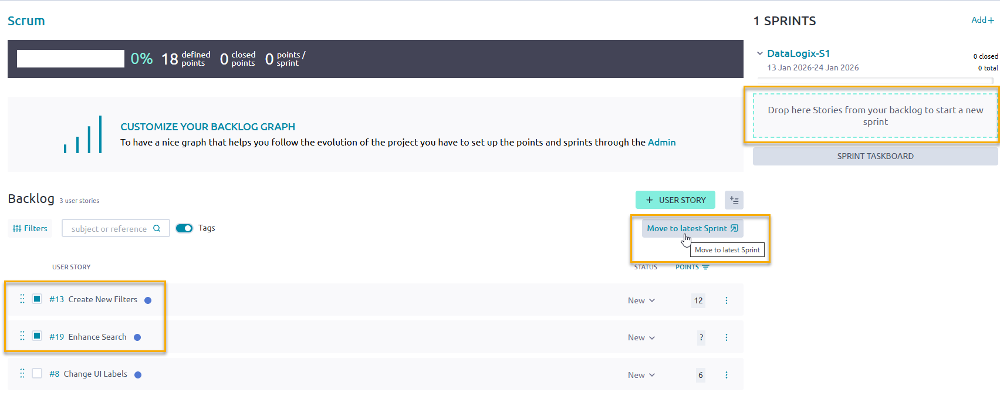

***

The stories you selected are now assigned to the sprint.

***

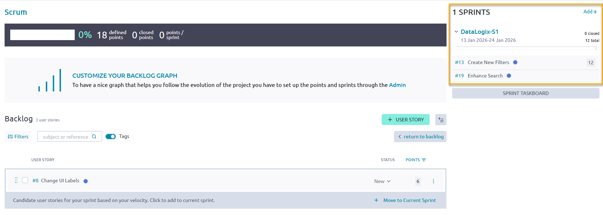

***

The application calculates your velocity based on your story points allocated to the sprint. If you can add additional stories to the sprint without exceeding your velocity, the system prompts you to move the candidate user stories to the current sprint.

3. To move candidate user stories to the current sprint, select **Move to Current Sprint**. +
   The system updates the assigned stories to the sprint.

*What to do next?* +
xref:track-progress-and-complete-user-stories[Track progress and complete user stories].

[[track-progress-and-complete-user-stories]]
=== Track progress and complete user stories

During a sprint, track the status of user stories on the **Sprint Taskboard**.

During the daily standups, discuss any blockers, issues, and dependencies, and try to resolve them so that members can complete the work defined in the relevant stories. At the end of a sprint, all stories should have a completed status.

*Before you begin*

xref:assign-stories-to-a-sprint[Assign user stories to a sprint].

*Procedure*

1. From the **Backlog**, select **Sprint Taskboard**.

***

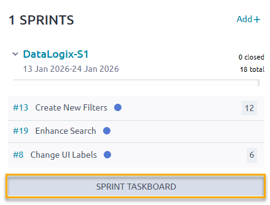

***

[TIP]
====
Alternatively, from the left sidebar, select **Scrum > {Sprint Name}**. For example, select **Scrum > DataLogix-S1**.
====

2. View the Sprint Taskboard.

***

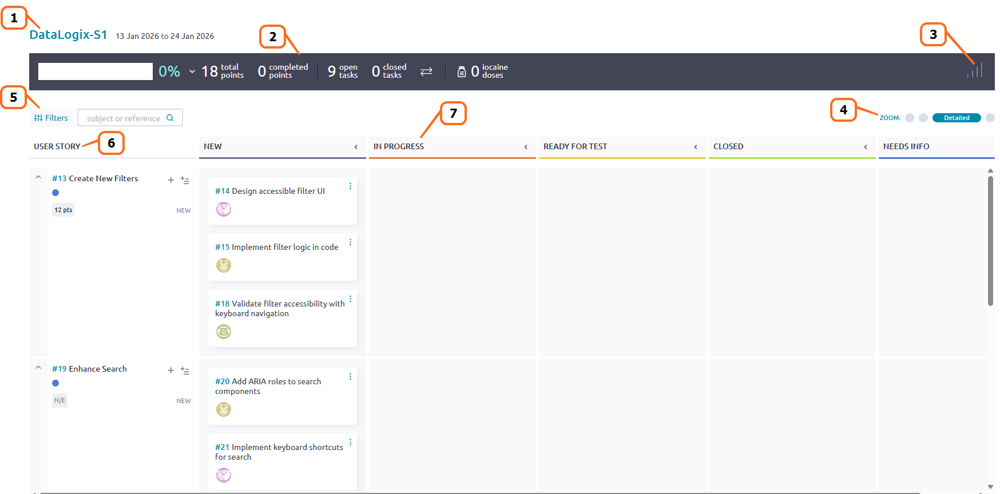

***

[options="header", cols="1,7"]
|===
| Seq. # | Description

| 1 | Sprint name and time frame.
| 2 | Sprint status summary, including the number of total story points, completed story points, open tasks, closed tasks, and iocaine doses. +
Iocaine doses are a Taiga-specific, playful gamification signal (a _Princess Bride_ reference) that a teammate is taking on a difficult or outside-their-comfort-zone task, and may need extra support or time.
| 3 | Burndown chart (when selected), which shows the sprint's approximate or projected progress based on estimated closed tasks.
| 4 | Zoom functionality, providing expanded and compact views of the board.
| 5 | Filter data (user stories and tasks) by keywords.
| 6 | Assigned user stories in the sprint.
| 7 | Status swim lanes, indicating the status of each task. +
Drag and drop tasks to the relevant status lane. When all tasks are in the **Closed** lane, the story is closed.
|===

3. To display the burndown chart, select the **Show statistics** icon. +
   This chart shows your team's progress in a sprint by displaying the remaining work against the time frame in which to complete it. The burndown chart helps identify if you're on track (below ideal line) or falling behind (above ideal line).

***

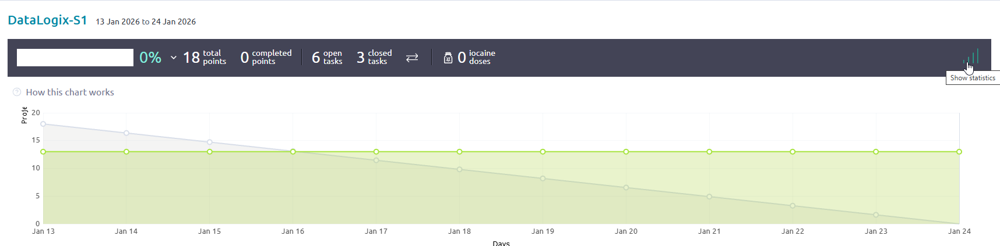

***

4. To add additional tasks to a story, select the **+** icon next to the story. You can also add multiple tasks at once using the **bulk task** icon .

***

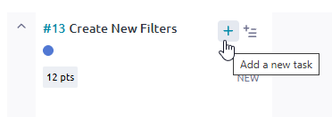

***

5. To accurately reflect any blockers and dependencies that arise, create any relevant issues:

   a. From **Sprint Issues**, select the **+** icon. +
   b. Enter a description of the issue. +
   c. Select **Add Issue**.

   Once an issue is created, you can track its progress, add attachments, assign to a specific member, edit, delete, or detach it from the sprint.

***

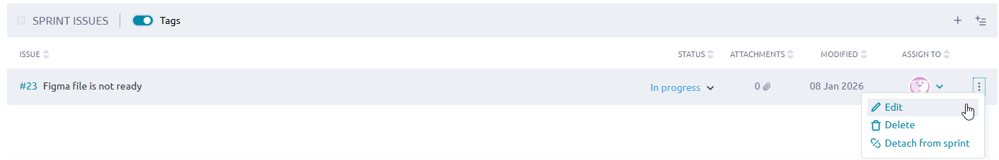

***

6. During the daily standups, change the status of tasks as required. At the end of a sprint, all stories should have a completed status.

***

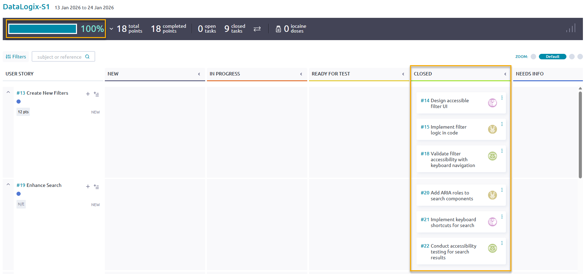

***
``